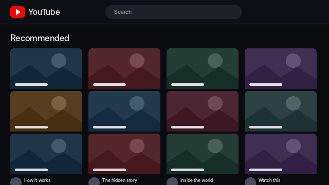
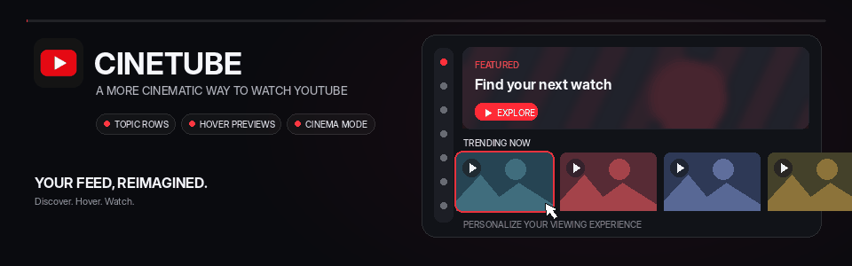
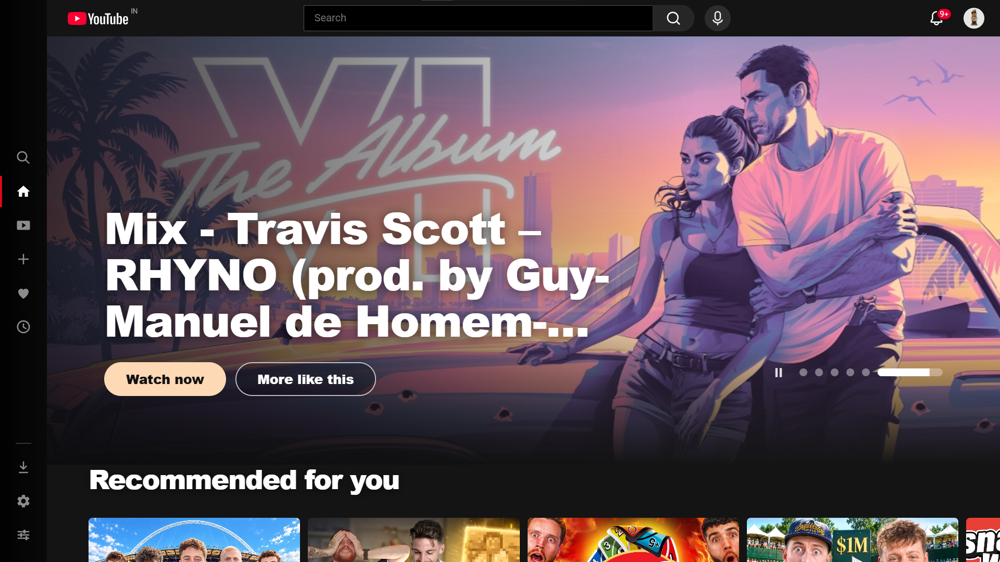
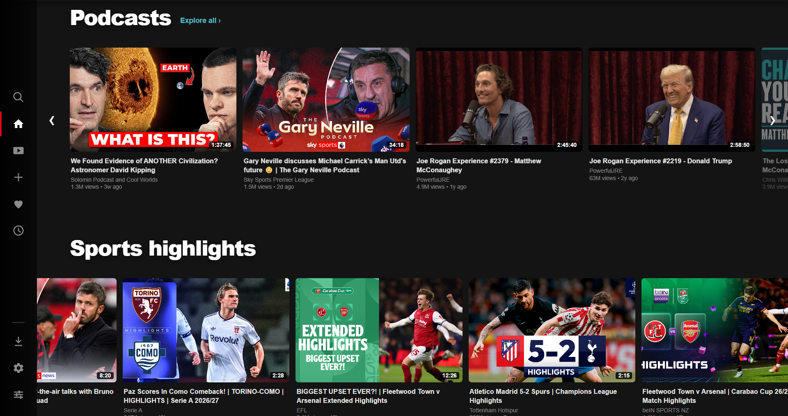
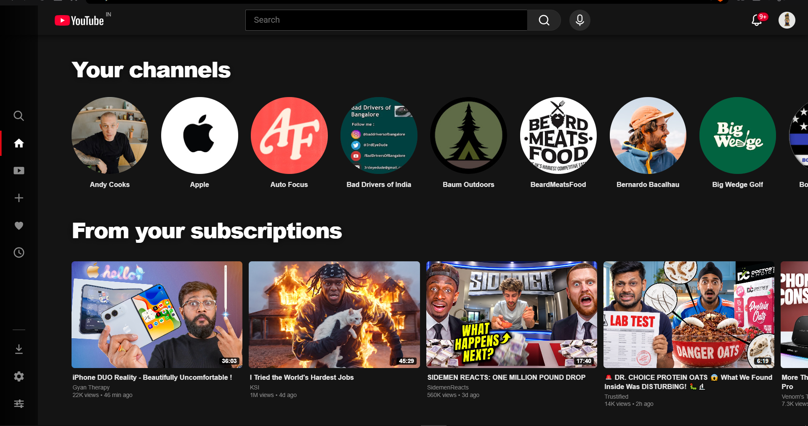
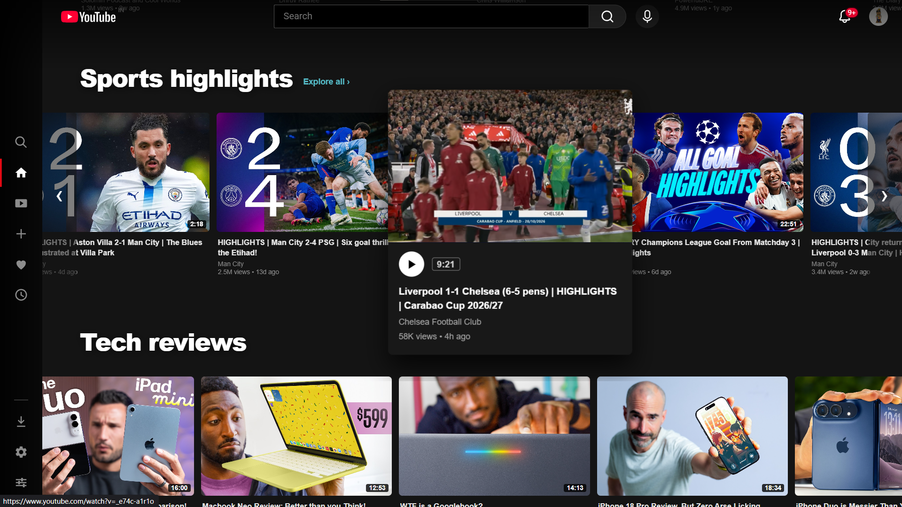
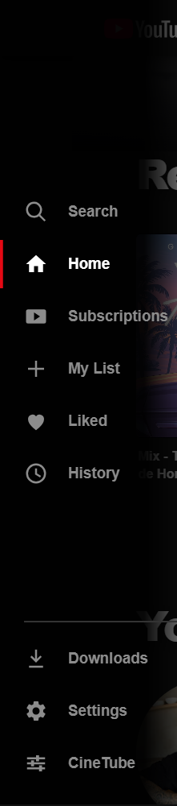

# CineTube

**A more cinematic way to browse YouTube.**

 

<em>From the familiar YouTube grid to a more cinematic way to browse.</em>

 

A closer look at the CineTube browsing experience.

---

CineTube changes the way YouTube looks and feels, taking inspiration from streaming catalogues. Instead of one long grid, the homepage brings together a featured video, topic rows and a cleaner navigation rail.

It is a personal project built to see how far the familiar YouTube experience can be reshaped with a browser extension.

## A look around

### The homepage

A featured area sits above the video rows, giving the page more of a streaming service feel.

### Browse by topic and channel

Topic rows bring related videos together, while channel discovery and subscription content make it easier to find something to watch.

  
  

### Hover previews

Video cards can show previews through YouTube's player when you hover over them. The speed and behaviour can vary, and this is still an area to improve.

### A smaller navigation rail

The sidebar keeps common destinations close by without taking up much of the screen.

  

## What is included

<ul>
  <li><strong>Featured billboard</strong> for highlighted videos.</li>
  <li><strong>Horizontal video rows</strong> organised around topics and subscriptions.</li>
  <li><strong>Video details</strong> such as channel, views and upload time.</li>
  <li><strong>Hover previews</strong> using YouTube's player.</li>
  <li><strong>Watch layouts</strong> with Cinema, Minimal and Classic modes.</li>
  <li><strong>Interface controls</strong> for options such as Shorts visibility and end screen cards.</li>
  <li><strong>Saved settings</strong> that remember your preferences.</li>
</ul>

The exact experience depends on YouTube's current interface and the settings you choose.

## Install it locally

CineTube is intended for local installation in a Chromium based browser.

1. Download this repository and extract it.
2. Open `chrome://extensions/` in your browser.
3. Turn on **Developer mode**.
4. Select **Load unpacked**.
5. Choose the project folder containing `manifest.json`.
6. Open YouTube in a new tab.

To update it later, download the latest files and click **Reload** on the CineTube extension card.

## Built with

<ul>
  <li>JavaScript</li>
  <li>HTML</li>
  <li>CSS</li>
  <li>Chrome Extensions Manifest V3</li>
  <li>Chrome Extension APIs</li>
</ul>

## Current status

CineTube is a work in progress. YouTube can change its page structure at any time, which may affect parts of the extension. Browser compatibility and hover preview performance still need testing.

If something breaks, open an issue with your browser version, the page where it happened and the steps to reproduce it.

## Disclaimer

CineTube is an independent project and is not affiliated with or endorsed by YouTube, Google or Netflix. Their names and trademarks belong to their respective owners.

## License

CineTube is available under the [MIT License](LICENSE). You can use, modify and distribute the code under its terms.
